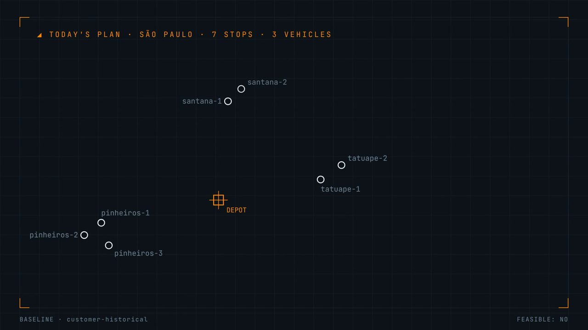

# QuantumClaw Route Optimizer

Agent skill: benchmark 3 route solvers on your delivery stops. Get the cheapest plan that serves every stop.

[](demo-video/final/quantumclaw-route-optimizer-demo.mp4)

▶ [Watch the demo (MP4, 67 s, narrated)](demo-video/final/quantumclaw-route-optimizer-demo.mp4)

## Install

- Any SKILL.md agent: `npx skills add yablokolabs/quantumclaw-route-optimizer`
- Claude Code, by hand: copy `skills/quantumclaw-route-optimizer/` to `.claude/skills/`
- Zip: [`dist/quantumclaw-route-optimizer.zip`](dist/quantumclaw-route-optimizer.zip)

## What it does

- Builds a validated routing problem from your CSV or JSON
- Runs 3 solvers, 5 seeded runs each
  - `classical`: greedy heuristic
  - `dwave-sa`: simulated annealing, classical, CPU
  - `dwave-sqa`: quantum annealing emulator, CPU
- Ranks plans: serves every stop first, then lowest median cost
- Compares against your current routes: km, cost, fuel, CO2
- Writes a Markdown report with each vehicle's stop order

## Needs

- Rust/cargo (one-time ~5 min build of the `quantumclaw` CLI)
- Python 3.9+ for the D-Wave Ocean solvers (local, no account)
- Optional: D-Wave Leap token for `dwave-hybrid` / `dwave-qpu`

## Try it

```text
São Paulo depot. 2 trucks (cap 12), 1 van (cap 8).
Today's 7 stops and our current routes: examples/sao-paulo-deliveries.json.
Find a better plan. Compare the solvers. Show what we save.
```

Result on the bundled example (seeds 1–5):

| Plan | Feasible runs | Median cost |
| --- | --- | --- |
| current plan | infeasible (truck-2 at 14/12) | 267.28 |
| classical | 0/5 | 234.49 |
| **dwave-sa** (winner) | 5/5 | 239.95 |
| dwave-sqa | 4/5 | 229.42 |

- Best plan: 61.6 km (from 78.0), cost 226.39 (from 267.28), CO2 32.9 kg (from 48.9)

## Repo layout

| Path | Contents |
| --- | --- |
| `skills/quantumclaw-route-optimizer/` | the skill: `SKILL.md`, scripts, input schema, examples |
| `dist/` | the skill as an upload-ready zip |
| `agensi/` | marketplace listing text, logo, screenshot |
| `demo-video/` | [Videowright](https://github.com/scosman/videowright) project for the demo video |

## Rebuild the demo video

- How it was made, step by step: [docs/how-it-was-built.md](docs/how-it-was-built.md)
- Quick rebuild:

```sh
cd demo-video
npm install && npx playwright install chromium
./videos/quantumclaw_agensi_demo/audio/originals/voiceovers/v1/setup_kokoro.sh
npx videowright render quantumclaw_agensi_demo --output final/quantumclaw-route-optimizer-demo.mp4
```

- Use it as a reference for your own demo: [prompt here](docs/how-it-was-built.md#use-as-a-reference-for-a-new-demo)

## Benchmark vs Google OR-Tools

13 public instances (Solomon VRPTW, Uchoa CVRP), 5 seeds per lane, one
independent checker: [benchmarks/](benchmarks/).

- OR-Tools won all 13. No QuantumClaw lane beat it, even at a 1-second budget.
- Time-window instances: QuantumClaw plans were late for 60–88 of 100 customers.
- Capacity-only instances: QuantumClaw plans were feasible but 48–167% longer than the best-known solutions; OR-Tools at 60 s was 1.9–6.4% above them.

## Limits

- Straight-line distances unless you supply a road matrix
- Time windows scored, not enforced during route building
- No pickup-delivery pairs, driver breaks or multi-day plans yet

## License

MIT, Yabloko Labs. Third-party parts: [THIRD_PARTY_NOTICES.md](THIRD_PARTY_NOTICES.md).
